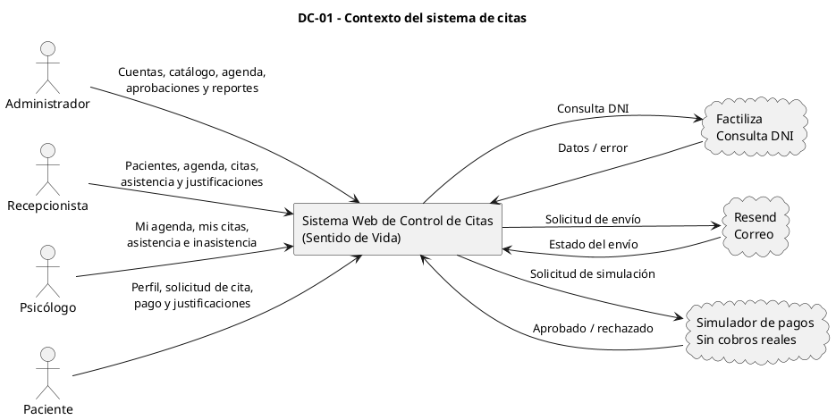

# INFORMACIÓN MAESTRA LRPD — SENTIDO DE VIDA

Actualización 16/11/2026: Fase 3.4 parcial. Se incorpora validación local de DNI y contratos PAC reservados; `/dashboard/mi-perfil` reutiliza únicamente el perfil de acceso autorizado, no una ficha de paciente. Lectura/escritura de pacientes y consultas DNI siguen bloqueadas por privilegios actuales. Véase [alcance técnico PAC](../servicios/PAC_FASE_3_4.md). No se ejecutó SQL remoto ni se modificaron permisos o datos.

Clasificación: **IMPLEMENTADO** = respaldado por código; **VERIFICADO** = resultado de pruebas/inspección identificada; **DOCUMENTADO** = afirmación de una fuente conservada, no auditada nuevamente; **PROPUESTO** = diseño sin ejecución; **PENDIENTE** = falta implementación, aprobación o evidencia. Fechas y alcance importan: la documentación de base de 14/11 no es un inventario remoto nuevo de hoy.

Fuentes locales revisadas:

- **F01:** `Estructura_Proyecto_Arquitectura_de_Software.pdf` (fuente local no publicada; excluida de GitHub)
- **F02:** `docs/Capitulo_I_Sistema_Citas_Psicologicas_Sentido_de_Vida.docx` (fuente local no publicada; excluida de GitHub)
- **F03:** `docs/Capitulo_II_Completo_Actualizado_Sentido_de_Vida.docx` (fuente local no publicada; excluida de GitHub)
- **F04:** `docs/Capitulo_III_Analisis_y_Modelado_Sentido_de_Vida.docx` (fuente local no publicada; excluida de GitHub)
- **F05:** `docs/Plan_Maestro_Proyecto_Sentido_de_Vida.docx` (fuente local no publicada; excluida de GitHub)
- **F06:** `docs/Documentacion_Unica_Base_de_Datos_Sentido_de_Vida.docx` (fuente local no publicada; excluida de GitHub)
- **F07:** `docs/DIAGRAMA DE CLASES ARQUIT SOFT.txt` (fuente local no publicada; excluida de GitHub)
- **F08:** [docs/seguridad/AUT.md](<../seguridad/AUT.md>)
- **F09:** [docs/seguridad/AUTHORIZATION_PROPOSAL.md](<../seguridad/AUTHORIZATION_PROPOSAL.md>)
- **F10:** [docs/base-de-datos/USERS_POSTGRES_ACTIVATION.md](<../base-de-datos/USERS_POSTGRES_ACTIVATION.md>)
- **F11:** [docs/servicios/USERS_SERVICE.md](<../servicios/USERS_SERVICE.md>)
- **F12:** [docs/evidencias/USERS_POSTGRES_SYNTHETIC_TESTS.md](<../evidencias/USERS_POSTGRES_SYNTHETIC_TESTS.md>)

Código/contratos/migración y pruebas se citan por rutas desde la raíz; los enlaces Markdown son relativos a este archivo. Documentación original conservada. No se ejecutó SQL remoto al organizar documentos.

## CAPÍTULO I. ASPECTOS GENERALES

### 1.1 Título del proyecto

Sistema Web para Mejorar el Control de Citas Psicológicas en el Centro Psicológico Particular Sentido de Vida – Ica, 2026.

### 1.2 Descripción del problema

El Capítulo I describe coordinación por WhatsApp y atención presencial, verificación manual de disponibilidad por recepción, agenda física y transcripción posterior a Excel. Esa dispersión puede ocasionar demoras, duplicidades, inconsistencias y dificultades de seguimiento. Se propone centralizar el control administrativo de citas, diferenciándolo del contenido clínico.

**Clasificación: DOCUMENTADO.** No se adjuntan observación de campo, entrevistas transcritas, tiempos de atención, conteos de duplicidad ni línea base cuantitativa. No convertir estas dificultades descritas en resultados estadísticos. Fuentes: Capítulo I, 1.2; Plan Maestro, 2.

### 1.3 Formulación del problema

Pregunta general del Capítulo I: **¿En qué medida el desarrollo de un sistema web mejorará el control de las citas psicológicas en el Centro Psicológico Particular Sentido de Vida – Ica, 2026?**

Preguntas específicas documentadas: efecto de las limitaciones actuales sobre el rendimiento; correspondencia de las funcionalidades con las necesidades de gestión; y contribución de la usabilidad a la interacción con el control de citas. **PENDIENTE:** operacionalizar variables, indicadores, población/muestra e instrumentos para responder «en qué medida». El funcionamiento técnico parcial no responde por sí solo esa pregunta.

### 1.4 Objetivo general

Desarrollar un sistema web para mejorar el control de las citas psicológicas en el Centro Psicológico Particular Sentido de Vida – Ica, 2026. Fuente: Capítulo I, 1.4. Es el objetivo del sistema completo, no una afirmación de mejora ya medida.

### 1.5 Objetivos específicos

1. Analizar el rendimiento del proceso actual de control de citas psicológicas en el Centro Psicológico Particular Sentido de Vida – Ica, 2026, identificando las actividades, dificultades y necesidades de sus usuarios.
2. Diseñar e implementar un prototipo funcional de un sistema web que permita gestionar la información de pacientes, psicólogos, horarios, citas y pagos anticipados en el Centro Psicológico Particular Sentido de Vida – Ica, 2026.
3. Evaluar la funcionalidad y la usabilidad del sistema web mediante pruebas y la participación de usuarios, con el propósito de determinar en qué medida facilita el control de las citas psicológicas en el Centro Psicológico Particular Sentido de Vida – Ica, 2026.

Se conservan los tres objetivos del capítulo existente (el PDF exige entre tres y cinco). Estado: análisis documental disponible; prototipo parcial AUT/Usuarios implementado; evaluación técnica parcial realizada. **PENDIENTE:** métricas de línea base, citas/pagos del prototipo y evaluación con usuarios. Ver 7.1–7.4 y 8.1.

### 1.6 Justificación

La justificación documentada comprende: **práctica**, centralizar registros y disponibilidad; **tecnológica**, aplicar tecnologías web y separación de responsabilidades; **académica**, relacionar requerimientos, modelos, arquitectura y atributos de calidad; **organizacional**, disminuir dependencia de registros dispersos y delimitar accesos. Fuentes: Capítulo I, 1.6.1–1.6.4.

La evidencia actual sustenta viabilidad de autenticación y consulta segura del perfil propio, no reducción de costos o demoras en el centro. Vercel, Resend y consulta DNI se mencionan como propuestas en el capítulo, no como integraciones desplegadas. **PENDIENTE:** sustento empírico y evaluación del beneficio organizacional.

### 1.7 Alcance

**Alcance previsto del sistema completo:** autenticación; gestión de pacientes, psicólogos y servicios; horarios y disponibilidad; solicitud, confirmación, cancelación y reprogramación de citas; pagos y devoluciones simuladas; correos y recordatorios; consulta DNI condicionada a autorización; reportes operativos. Fuentes: Capítulo I, 1.7; Capítulo II y Plan Maestro.

**Alcance implementado a Fase 3.3:** monorepositorio npm; portada, login y dashboard protegido; cierre de sesión; errores accesibles; contratos y evaluador compartido; API Usuarios de perfil propio; PostgreSQL restringido con TLS/preflight/RLS y auditoría; nombre del perfil en dashboard mediante HTTP exclusivamente desde el servidor.

**Exclusiones documentadas:** historia clínica, diagnósticos/notas de sesiones, teleconsulta, aplicación móvil nativa y cobros/devoluciones de dinero real. El esquema existente no convierte los módulos de negocio futuros en funcionalidades web implementadas.

**Discrepancia a resolver:** Capítulo I enumera tres perfiles en algunos pasajes; Capítulo II, Plan Maestro, CHECK documentado y contratos vigentes incluyen cuatro: administrador, recepcionista, psicólogo y paciente. Para describir el diseño actual usar cuatro y dejar pendiente armonizar el texto académico original, sin alterarlo en esta tarea.

## CAPÍTULO II. REQUERIMIENTOS DEL SISTEMA

### 2.1 Actores

Fuente: Capítulo II, 2.1; Plan Maestro, 4. Las responsabilidades siguientes son el alcance previsto, no privilegios concedidos por el dashboard.

| Código | Actor | Responsabilidad documentada | Estado de acceso real |
| --- | --- | --- | --- |
| ACT-01 | Administrador | Cuentas/permisos, catálogo, horarios, autorizaciones, reportes | AUT y perfil propio; administración pendiente |
| ACT-02 | Recepcionista | Pacientes, citas/agendas, pagos consultables, asistencia y justificaciones | AUT y perfil propio; operaciones pendientes |
| ACT-03 | Psicólogo | Agenda y citas asignadas, asistencia/inasistencia | AUT y perfil propio; agenda pendiente |
| ACT-04 | Paciente | Perfil, disponibilidad, solicitud de cita, pago simulado y solicitudes justificadas | AUT y perfil propio; sin registro público ni citas |
| EXT-01 | Factiliza | Consulta de identidad/DNI condicionada a acceso autorizado | PENDIENTE |
| EXT-02 | Resend | Correos transaccionales | PENDIENTE |
| EXT-03 | Simulador de pagos | Aprobación/rechazo sin dinero real | PENDIENTE |

Supabase Auth y PostgreSQL son dependencias técnicas efectivamente integradas, no actores humanos ni roles de negocio. `svc_*`, `sdv_users_app`, `anon` y `authenticated` son identidades técnicas diferentes de los cuatro roles de aplicación.

### 2.2 Requerimientos funcionales

Se conservan los **52 RF** del Capítulo II, 2.2, con su código y formulación. «PENDIENTE» se refiere a la aplicación/casos de uso, aunque existan tablas o reglas SQL documentadas. Los ocho módulos funcionales no equivalen a ocho microservicios.

| Código | Requerimiento documentado | Estado a Fase 3.3 |
| --- | --- | --- |
| RF-AUT-01 | El sistema deberá permitir que los usuarios autorizados inicien sesión mediante sus credenciales registradas. | IMPLEMENTADO: login Auth |
| RF-AUT-02 | El sistema deberá permitir que los usuarios cierren su sesión de forma segura. | IMPLEMENTADO: logout local |
| RF-AUT-03 | El sistema deberá permitir al administrador registrar, consultar, actualizar y desactivar las cuentas de administrador, recepcionista y psicólogo. | PENDIENTE |
| RF-AUT-04 | El sistema deberá asignar a cada cuenta uno de los roles autorizados: administrador, recepcionista, psicólogo o paciente. | PARCIAL: contratos/CHECK de roles; asignación administrativa pendiente |
| RF-AUT-05 | El sistema deberá restringir las funciones y los datos de cada sesión según el rol autenticado y, para el psicólogo, según las citas que tenga asignadas. | PARCIAL: sesión y perfil propio; matriz de negocio completa pendiente |
| RF-AUT-06 | El sistema deberá permitir que el usuario solicite la recuperación de acceso mediante el mecanismo de recuperación configurado. | PENDIENTE |
| RF-PAC-01 | El sistema deberá permitir registrar los datos personales y de contacto de un paciente. | PENDIENTE |
| RF-PAC-02 | El sistema deberá permitir consultar los datos de un paciente mediante su número de DNI. | PENDIENTE |
| RF-PAC-03 | El sistema deberá permitir completar o corregir los datos del paciente después de una consulta de identidad, previa verificación por el propio paciente o por el personal autorizado. | PENDIENTE |
| RF-PAC-04 | El sistema deberá validar que el número de DNI tenga ocho dígitos numéricos antes de realizar la consulta o el registro. | PARCIAL: validador puro implementado/probado; registro y consulta permanecen bloqueados |
| RF-PAC-05 | El sistema deberá permitir al administrador y al recepcionista consultar y actualizar la información de los pacientes de acuerdo con sus permisos. | PENDIENTE |
| RF-PAC-06 | El sistema deberá permitir al paciente consultar y actualizar los datos de contacto habilitados para su perfil. | PENDIENTE |
| RF-CAT-01 | El sistema deberá permitir al administrador registrar, consultar, actualizar y desactivar los perfiles de los psicólogos del centro. | PENDIENTE |
| RF-CAT-02 | El sistema deberá permitir registrar y actualizar la especialidad y los datos profesionales de cada psicólogo. | PENDIENTE |
| RF-CAT-03 | El sistema deberá permitir al administrador registrar, consultar, actualizar y desactivar los servicios psicológicos ofrecidos por el centro. | PENDIENTE |
| RF-CAT-04 | El sistema deberá permitir asociar cada servicio psicológico con su duración y precio vigente. | PENDIENTE |
| RF-CAT-05 | El sistema deberá mostrar a los pacientes los servicios disponibles y la información necesaria para solicitar una cita. | PENDIENTE |
| RF-CAT-06 | El sistema deberá permitir al psicólogo consultar su perfil profesional registrado sin modificar los perfiles de otros psicólogos. | PENDIENTE |
| RF-HOR-01 | El sistema deberá permitir al administrador o recepcionista registrar y actualizar los horarios de atención de cada psicólogo. | PENDIENTE |
| RF-HOR-02 | El sistema deberá permitir consultar la disponibilidad de un psicólogo según la fecha, el horario y el servicio seleccionado; el psicólogo podrá consultar su propia disponibilidad. | PENDIENTE |
| RF-HOR-03 | El sistema deberá mostrar únicamente los horarios que no estén ocupados por citas confirmadas ni bloqueados por el personal autorizado. | PENDIENTE |
| RF-HOR-04 | El sistema deberá permitir registrar bloqueos de horarios por vacaciones, permisos, reuniones u otras indisponibilidades del psicólogo. | PENDIENTE |
| RF-HOR-05 | El sistema deberá actualizar la disponibilidad cuando una cita cambie de estado o se libere un horario. | PENDIENTE |
| RF-CIT-01 | El sistema deberá permitir que el paciente solicite una cita seleccionando un servicio, un psicólogo, una fecha y un horario disponible. | PENDIENTE |
| RF-CIT-02 | El sistema deberá permitir que el recepcionista registre una cita en nombre de un paciente. | PENDIENTE |
| RF-CIT-03 | El sistema deberá verificar la disponibilidad del horario antes de aceptar una solicitud de cita. | PENDIENTE |
| RF-CIT-04 | El sistema deberá crear una cita en estado pendiente de pago mientras se completa el proceso de pago, sin considerarla confirmada ni reservarla definitivamente. | PENDIENTE |
| RF-CIT-05 | El sistema deberá confirmar la cita cuando reciba y valide el resultado aprobado del pago anticipado o total correspondiente. | PENDIENTE |
| RF-CIT-06 | El sistema deberá permitir consultar las citas por paciente, psicólogo, fecha y estado, mostrando a cada paciente solo sus propias citas y a cada psicólogo solo sus citas asignadas. | PENDIENTE |
| RF-CIT-07 | El sistema deberá permitir que el paciente solicite la cancelación o reprogramación de una cita. | PENDIENTE |
| RF-CIT-08 | El sistema deberá permitir al administrador o recepcionista aprobar o rechazar las solicitudes de cancelación y reprogramación que requieran justificación. | PENDIENTE |
| RF-CIT-09 | El sistema deberá permitir reprogramar una cita aprobada, verificando la disponibilidad del nuevo horario antes de efectuar el cambio. | PENDIENTE |
| RF-CIT-10 | El sistema deberá permitir actualizar el estado de una cita a confirmada, cancelada, reprogramada, atendida o inasistencia, según corresponda. | PENDIENTE |
| RF-CIT-11 | El sistema deberá permitir al psicólogo registrar la asistencia o inasistencia únicamente en las citas que tenga asignadas, y al administrador o recepcionista registrar dicho estado en las citas del centro. | PENDIENTE |
| RF-CIT-12 | El sistema deberá conservar el historial de cambios de estado, reprogramaciones y cancelaciones de cada cita. | PENDIENTE |
| RF-PAG-01 | El sistema deberá calcular el importe del anticipo equivalente al 50 % del precio vigente del servicio seleccionado. | PENDIENTE |
| RF-PAG-02 | El sistema deberá permitir simular el pago del anticipo o del importe total de una cita. | PENDIENTE |
| RF-PAG-03 | El sistema deberá registrar el importe, la fecha, el método simulado, el resultado y el identificador de cada transacción. | PENDIENTE |
| RF-PAG-04 | El sistema deberá actualizar el estado del pago a aprobado o rechazado según el resultado devuelto por el simulador. | PENDIENTE |
| RF-PAG-05 | El sistema deberá comunicar al módulo de citas el resultado validado del pago para que se confirme la cita cuando corresponda. | PENDIENTE |
| RF-PAG-06 | El sistema deberá permitir al administrador y al recepcionista consultar los pagos asociados a una cita. | PENDIENTE |
| RF-PAG-07 | El sistema deberá registrar las devoluciones simuladas que correspondan a solicitudes de cancelación aprobadas. | PENDIENTE |
| RF-PAG-08 | El sistema deberá conservar el historial de pagos y devoluciones asociados a cada cita. | PENDIENTE |
| RF-NOT-01 | El sistema deberá solicitar el envío de un correo electrónico al confirmarse una cita. | PENDIENTE |
| RF-NOT-02 | El sistema deberá solicitar el envío de un correo electrónico cuando una cita sea cancelada o reprogramada. | PENDIENTE |
| RF-NOT-03 | El sistema deberá programar el envío de un recordatorio de cita con 24 horas de anticipación, siempre que la cita continúe confirmada. | PENDIENTE |
| RF-NOT-04 | El sistema deberá registrar el tipo de notificación, destinatario, fecha de solicitud y resultado del envío. | PENDIENTE |
| RF-NOT-05 | El sistema deberá permitir consultar el estado de las notificaciones generadas. | PENDIENTE |
| RF-ADM-01 | El sistema deberá proporcionar al administrador un panel con indicadores generales de citas, pacientes, psicólogos y pagos. | PENDIENTE |
| RF-ADM-02 | El sistema deberá permitir consultar reportes de citas por rango de fechas, psicólogo y estado. | PENDIENTE |
| RF-ADM-03 | El sistema deberá permitir consultar reportes de pagos y devoluciones por rango de fechas y estado. | PENDIENTE |
| RF-ADM-04 | El sistema deberá permitir al administrador consultar el historial de operaciones administrativas relevantes. | PENDIENTE |

La lectura `id/displayName` no implementa edición de contacto, gestión de pacientes ni panel administrativo. El backend de Usuarios reutiliza `users.profile.read`; no hay endpoints CRUD de los otros módulos.

### 2.3 Requerimientos no funcionales

Los siguientes **16 RNF** son metas documentadas del Capítulo II, 2.3. No presentar umbrales como resultados medidos.

| Código | Meta documental | Evidencia / estado |
| --- | --- | --- |
| RNF-01 | El sistema deberá responder en un máximo de 3 segundos al menos al 95 % de las consultas de citas y disponibilidad durante una prueba con 50 usuarios concurrentes, excluyendo el tiempo de respuesta de proveedores externos. | PENDIENTE: sin medición o prueba integral disponible |
| RNF-02 | El sistema deberá completar en un máximo de 4 segundos al menos al 95 % de las operaciones de registro y actualización durante una prueba con 50 usuarios concurrentes, excluyendo proveedores externos. | PENDIENTE: sin medición o prueba integral disponible |
| RNF-03 | El sistema deberá exigir autenticación válida en el 100 % de las operaciones privadas y rechazar solicitudes sin sesión vigente. | PARCIAL: AUT/Usuarios probado; resto sin implementar |
| RNF-04 | El sistema deberá verificar en el servidor los permisos de cada operación protegida, restringiendo al psicólogo a sus citas asignadas y al paciente a sus propios registros. | PARCIAL: perfil propio; roles/recursos futuros no probados en producción |
| RNF-05 | El sistema deberá utilizar HTTPS en el 100 % de las comunicaciones externas y mantener claves de integración fuera del código fuente publicado. | PARCIAL: Auth HTTPS y cliente→pooler verificado; web/API local por loopback; despliegue pendiente |
| RNF-06 | El sistema deberá impedir que un paciente consulte o modifique registros de otro paciente y que un psicólogo acceda a citas de otros profesionales. | PARCIAL: aislamiento de perfiles probado; pacientes y citas no implementados |
| RNF-07 | El sistema no deberá almacenar diagnósticos, notas clínicas ni contenido de sesiones psicológicas en la primera versión. | Exclusión vigente; no hay funcionalidad clínica implementada |
| RNF-08 | El sistema deberá tener como objetivo una disponibilidad mensual mínima del 99 %, medida mediante verificaciones periódicas de su punto de acceso, sin atribuir al prototipo garantías superiores a las del proveedor. | PENDIENTE: sin medición o prueba integral disponible |
| RNF-09 | El sistema deberá disponer de un procedimiento documentado de respaldo y restauración de datos, verificable mediante al menos una prueba de recuperación. | PENDIENTE: sin medición o prueba integral disponible |
| RNF-10 | El sistema deberá permitir desplegar cada microservicio de forma independiente cuando no existan cambios incompatibles en sus contratos. | PENDIENTE: sin medición o prueba integral disponible |
| RNF-11 | El sistema deberá organizar su código por responsabilidades y mantener documentados los contratos de API, las variables de entorno y los pasos de despliegue de cada servicio. | PARCIAL: Usuarios modular y contratos; cuatro servicios solo preparados |
| RNF-12 | El sistema deberá intercambiar datos entre servicios mediante interfaces documentadas con formatos JSON y códigos de respuesta HTTP definidos para cada operación. | PARCIAL: contrato JSON/HTTP de perfil propio |
| RNF-13 | El sistema deberá permitir que al menos el 80 % de cinco usuarios de prueba complete sin asistencia las tareas de consultar disponibilidad y solicitar una cita. | PENDIENTE: sin medición o prueba integral disponible |
| RNF-14 | El sistema deberá mantener utilizables las funciones principales en pantallas de ancho comprendido entre 360 y 1920 píxeles, sin desplazamiento horizontal de la página. | PARCIAL: UI responsive y comprobaciones AUT documentadas; rango completo por certificar |
| RNF-15 | El sistema deberá impedir la confirmación de citas con intervalos superpuestos para un mismo psicólogo, incluso ante dos solicitudes simultáneas. | PENDIENTE: sin medición o prueba integral disponible |
| RNF-16 | El sistema deberá registrar fecha, operación, identificador de cita y actor responsable en el 100 % de las confirmaciones, cancelaciones, reprogramaciones y devoluciones. | PENDIENTE: sin medición o prueba integral disponible |

### 2.4 Reglas de negocio

Las **18 reglas** proceden del Capítulo II, 2.4. Son políticas del prototipo documentado; no se presentan como normas legales o resultados del centro. Algunos controles figuran en la documentación de la base existente; sus flujos de aplicación siguen pendientes.

- **RN-01:** Todo paciente que solicite una cita deberá estar identificado mediante un número de DNI válido de ocho dígitos.
- **RN-02:** El paciente deberá pagar como mínimo el 50 % del precio vigente del servicio para que la cita pueda ser confirmada.
- **RN-03:** El paciente podrá pagar el 100 % del precio vigente del servicio al momento de solicitar la confirmación de la cita.
- **RN-04:** Una cita solo podrá pasar al estado confirmada cuando el Servicio de Pagos haya informado un resultado aprobado por un importe igual o superior al anticipo requerido.
- **RN-05:** Un horario solo podrá confirmarse para una cita cuando el pago anticipado o total haya sido aprobado y validado.
- **RN-06:** Un psicólogo no podrá tener dos citas confirmadas cuyos intervalos de atención se superpongan, aunque las solicitudes se reciban simultáneamente.
- **RN-07:** La duración de cada cita deberá corresponder a la duración definida para el servicio psicológico seleccionado al momento de su confirmación.
- **RN-08:** El importe de una cita deberá calcularse utilizando el precio vigente del servicio al momento de iniciar la solicitud de reserva; dicho importe deberá conservarse en el registro de la cita.
- **RN-09:** Una solicitud de cita pendiente de pago deberá mantenerse durante un máximo de 10 minutos. Transcurrido ese plazo sin un pago aprobado, deberá expirar y dejar de mostrarse como solicitud activa.
- **RN-10:** Cuando un paciente no asista a una cita y presente una justificación aprobada por el administrador o recepcionista, podrá solicitar una reprogramación sin perder el anticipo previamente pagado y validado.
- **RN-11:** El paciente deberá presentar la justificación de inasistencia dentro de las 48 horas posteriores a la fecha y hora programadas de la cita.
- **RN-12:** Una cita con inasistencia justificada podrá reprogramarse una sola vez conservando el anticipo previamente validado.
- **RN-13:** Toda reprogramación deberá asignarse a un horario disponible y no podrá generar superposición con otra cita confirmada del mismo psicólogo.
- **RN-14:** Cuando el paciente solicite la cancelación de una cita y la justificación sea aprobada por el administrador o recepcionista, corresponderá la devolución del 100 % del anticipo efectivamente pagado y validado.
- **RN-15:** Toda devolución aprobada deberá registrarse asociada a la cita y al pago original, indicando el importe, la fecha y el estado de la operación.
- **RN-16:** Un pago con resultado rechazado no podrá confirmar una cita ni reservar definitivamente el horario solicitado.
- **RN-17:** Solo el administrador o el recepcionista podrá aprobar o rechazar las justificaciones de inasistencia y cancelación.
- **RN-18:** Toda cita confirmada, cancelada o reprogramada deberá generar una solicitud de notificación por correo electrónico al paciente.

Resumen de decisiones operativas: anticipo mínimo 50 %, pago total opcional, confirmación solo con pago aprobado validado, pendientes durante diez minutos, justificación dentro de 48 horas, una reprogramación justificada conservando anticipo y devolución simulada del 100 % del anticipo validado cuando se aprueba la cancelación. Recordatorio de 24 horas figura en RF-NOT-03. **PENDIENTE:** validar institucionalmente y demostrar estos flujos completos; las pruebas de perfil propio no los cubren.

### 2.5 Casos de uso

Casos del Capítulo II, 2.5; especificación completa en el DOCX original.

| Caso | Objetivo y actores | Precondición / resultado previstos | Estado |
| --- | --- | --- | --- |
| CU-01 | Acceso; cuatro roles humanos | Cuenta activa; autenticar y habilitar funciones permitidas | PARCIAL: login/logout y perfil; CRUD de cuentas/recuperación pendientes |
| CU-02 | Pacientes; paciente/recepción/admin y Factiliza | Actor autorizado; validar DNI y datos permitidos | PENDIENTE |
| CU-03 | Psicólogos/servicios; admin y psicólogo | Sesión autorizada; mantener catálogo/perfil profesional | PENDIENTE |
| CU-04 | Horarios; cuatro roles | Profesional/servicio activos; consultar franjas y bloqueos | PENDIENTE |
| CU-05 | Ciclo de cita; cuatro roles | Identificación y disponibilidad; pago validado, historial y cambios | PENDIENTE |
| CU-06 | Pagos/devoluciones simulados; paciente/recepción/admin y simulador | Cita pendiente o cancelación aprobada; trazabilidad sin dinero real | PENDIENTE |
| CU-07 | Notificaciones; paciente y Resend | Evento de cita; correo e intento trazado | PENDIENTE |
| CU-08 | Información administrativa; admin | Autorización; indicadores/reportes filtrados | PENDIENTE |

Para CU-01 están probadas credenciales inválidas, sesión ausente/expirada y cierre; cuenta/perfil inactivo recibe rechazo genérico del servicio. Los flujos alternativos restantes están especificados en los capítulos, no implementados.

## CAPÍTULO III. ANÁLISIS Y MODELADO

### 3.1 Diagrama de contexto

Existe DC-01 en el Capítulo III, 3.1. Se reproduce su código **existente** como contexto del sistema objetivo; Factiliza, Resend y pagos son propuestas, no integraciones actuales. No es un diagrama nuevo ni una prueba de despliegue.



**PENDIENTE:** renderizar/validar la figura y distinguir visualmente la vista actual AUT/Usuarios de la vista objetivo.

### 3.2 Diagrama de casos de uso

El Capítulo III, 3.2.1–3.2.8, contiene ocho bloques PlantUML DCU-01 a DCU-08, uno por módulo de CU-01 a CU-08. Se conservó el DOCX fuente sin modificaciones. **PENDIENTE:** renderizar los diagramas y validar asociaciones contra la matriz autorizada; DCU-01 incluye funciones futuras que no deben presentarse como implementadas. No se generaron óvalos ni actores adicionales.

### 3.3 Diagrama de clases

Modelo conceptual existente: `docs/DIAGRAMA DE CLASES ARQUIT SOFT.txt` (PlantUML) y referencia en Capítulo III, 3.3. Contempla usuarios/especializaciones, Rol/Permiso/Sesión, pacientes, catálogo, citas, pagos, notificaciones y administración.

**Diferencias con implementación:** el diagrama conceptual incluye `contrasenaHash` y clases Rol/Permiso; la aplicación delega credenciales a Supabase Auth y usa `perfiles.rol` TEXT con cuatro valores y un evaluador TypeScript. No se acreditan tablas de roles/permisos ni almacenamiento local de hashes. El modelo de clases no equivale al esquema PostgreSQL físico.

**PENDIENTE:** armonizar clases con identidad Auth, contratos y persistencia actual, renderizar y validar multiplicidades. No se modifica el modelo académico original en esta reorganización.

### 3.4 Diagrama de secuencia

Hay ocho secuencias PlantUML DSE-01 a DSE-08 en Capítulo III, 3.4.1–3.4.8. **Advertencia comprobada:** DSE-01 propone que Usuarios autentica validando un hash y devuelve token/rol; el flujo real autentica en Supabase Auth. También usa un participante `Usuario` diferente del alias `Actor`. No reproducir esa secuencia como evidencia de la implementación actual.

Flujo actual extraído del código, en texto: formulario → Server Action Auth → Supabase; proxy SSR → verificación en servidor del mismo token → HTTP Usuarios → JWT verificado → BEGIN → contexto local → SELECT perfil → autorización compartida → INSERT auditoría → COMMIT → contrato mínimo → nombre renderizado.

**PENDIENTE:** actualizar y renderizar DSE-01 para Fase 3.3; revisar las otras siete secuencias como propuestas, no como funciones operativas. No se creó un diagrama sustituto inventado.

### 3.5 Diagrama de actividades

El Capítulo III, 3.5, documenta ocho procesos con variantes AS IS / TO BE (3.5.1.1–3.5.8.2), indicando Bizagi Modeler/BPMN 2.0. Se encontraron descripciones/tablas, no archivos BPMN ni imágenes embebidas en los DOCX revisados.

**PENDIENTE:** elaborar/exportar las figuras BPMN de actividades y validar carriles, decisiones, eventos y excepciones con responsables del centro. Mantener claramente separados proceso actual, proceso objetivo y software realmente implementado.

No se encontró código Mermaid existente en los Markdown revisados. Los modelos textuales disponibles son PlantUML; no se convierten a Mermaid ni se certifica su renderizado sin validación.

## CAPÍTULO IV. ARQUITECTURA DE SOFTWARE

### 4.1 Principios arquitectónicos

Principios sustentados por el código: separación frontend/Auth/dominio/persistencia; cohesión por dominio; contratos públicos sin dependencias de persistencia; inyección de puertos para identidad/repositorio/auditoría; mínimo privilegio; denegación por defecto; proyección mínima; no confiar en roles/identificadores del navegador; no compartir sesiones entre peticiones.

Trazas: `services/users/src/application/ports.ts`, `application/get-own-profile.ts`, `postgres/unit-of-work.ts`, `packages/contracts/src/users.ts`, `authorization-policy.ts` y `apps/web/src/lib/users/`. La independencia de despliegue de los cinco servicios sigue siendo una meta, no una propiedad probada con cinco despliegues.

### 4.2 Estilo arquitectónico seleccionado

Arquitectura objetivo: cliente-servidor con cinco microservicios/dominios —Usuarios, Catálogo, Citas, Pagos y Notificaciones—, frontend único y persistencia compartida físicamente pero separada por esquemas. Fuente: Plan Maestro, 6 y 10.

Arquitectura comprobada: Next.js App Router/SSR como interfaz y composición de llamadas servidor→API; Usuarios con HTTP nativo Node.js y capas de transporte, aplicación, dominio, repositorios y seguridad. Cuatro servicios conservan únicamente scaffolding. No hay API pública Next duplicando reglas de Usuarios, ni consultas del frontend a tablas internas. Es una implementación parcial de la arquitectura de microservicios, no cinco servicios de negocio completos.

### 4.3 Justificación de la arquitectura

La elección documentada alinea límites de Usuarios/Catálogo/Citas/Pagos/Notificaciones con responsabilidades y propiedad lógica de datos. npm workspaces facilita compartir contratos y ejecutar validaciones sin fusionar propietarios de datos. La API de perfil mantiene al frontend independiente de tablas y privilegios SQL.

Justificación de seguridad observada: reemplazar acceso administrativo por LOGIN restringido evita heredar CRUD amplio de svc_usuarios; el servidor verifica identidad, el dominio autoriza y RLS limita filas. La transacción exige auditoría antes de entregar el perfil.

Costos y límites: más contratos, fallos de red, operación y coordinación entre dominios; misma instancia PostgreSQL comparte disponibilidad y recursos. No se han comparado experimentalmente rendimiento/costo frente a un monolito. No afirmar superioridad cuantitativa ni escalabilidad ya demostrada.

### 4.4 Diagrama de arquitectura

La vista textual comprobada es navegador ↔ Next.js SSR → API HTTP Usuarios → PostgreSQL (esquema usuarios), con Supabase Auth para identidad. Catálogo/Citas/Pagos/Notificaciones son límites previstos con paquetes preparados. Todos los esquemas funcionales residen en una instancia Supabase existente.

**PENDIENTE:** diagrama de arquitectura actual y objetivo que distinga componentes implementados, planeados y fronteras de confianza. No se encontró una figura general consolidada actualizada a Fase 3.3; el contexto DC-01 no la sustituye.

### 4.5 Diagrama de componentes

Componentes reales: proxy/cliente Auth SSR; flujos AUT; Server Component dashboard; adaptador servidor de perfil; transporte HTTP Usuarios; verificador JWT; caso de uso; evaluador compartido; repositorio pg; unidad de trabajo; auditoría y preflight. Contratos: `@sentido/contracts` y subpath `authorization-design`.

**PENDIENTE:** renderizar un diagrama de componentes con interfaces y dependencias. No existe un framework Express/Nest implementado; el transporte usa node:http. Los paquetes contratos no incorporan acceso SQL.

### 4.6 Diagrama de despliegue

Evidencia local: procesos Next.js y Usuarios en loopback, con PostgreSQL/Auth remotos en Supabase. Usuarios escucha por defecto en 127.0.0.1:4001. PostgreSQL se conecta mediante Session Pooler y TLS cliente verificado. La validación temporal de Fase 3.3 cerró sus servidores al finalizar; no hay evidencia de una aplicación web publicada.

**PENDIENTE:** diagrama de despliegue, redes/fronteras TLS, ambientes y operación de cinco servicios. Vercel figura como propuesta en Capítulo I; no se acredita despliegue, contenedores, balanceadores, réplicas ni alta disponibilidad del sistema completo.

### 4.7 Patrones de diseño

Patrones identificados en código: repositorio (`ProfileRepository` / `PostgresProfileRepository`), puertos/adaptadores (identidad, persistencia y auditoría), unidad de trabajo transaccional (`PostgresUnitOfWork`), composición/inyección de dependencias (`runtime.ts`) y frontera servidor para consumo de APIs (Server Component/adaptador servidor Next).

Outbox/inbox e idempotencia están documentados como diseño de datos para Citas/Pagos; no hay un bus/consumidor de eventos implementado en los servicios. No atribuir a la aplicación CQRS, Saga, circuit breaker o service mesh sin código/evidencia.

### 4.8 Decisiones arquitectónicas

Decisiones extraídas de fuentes reales; no son actas de aprobación institucional ni ADR firmados.

| Decisión | Sustento / alternativa descartada | Estado |
| --- | --- | --- |
| npm workspaces, Node 24 | package.json raíz y lock; conservar apps/services/packages | Implementada |
| Cinco propietarios lógicos | Plan Maestro y esquemas; ocho módulos no implican ocho servicios | Diseño y scaffolding; Usuarios operativo |
| Supabase Auth y API backend | Evita tablas internas desde frontend y hashes locales | Implementada AUT/Usuarios |
| LOGIN con grants directos mínimos | Heredar svc_usuarios o SET ROLE ampliaría a CRUD de otras tablas de usuarios | Implementada y probada en Fase 3.2E |
| Contexto transaccional del actor | set_config local después de JWT; evita estado de sesión reutilizado | Implementada y probada |
| Auditoría atómica de lectura | No devolver perfil si no se confirma auditoría; no usar auditorías de Citas/Pagos | Implementada |
| TLS según tramo en session | pg_stat_ssl mide pooler→PostgreSQL; driver exige socket cliente autorizado, CA y hostname | Implementada; no garantiza TLS interno |
| Frontend solo servidor y no-store | Ruta fija, token verificado y respuesta mínima; sin perfiles ajenos por parámetros | Implementada en Fase 3.3 |
| Retención propuesta de auditoría de 90 días | Procedimiento operativo y permisos de lectura/purga no aprobados | PENDIENTE; no plazo legal afirmado |

Fuentes: documentos de seguridad/Usuarios/base de datos reorganizados y código referenciado en 4.1. Formalizar alternativas, responsables y criterios de revisión de ADR queda pendiente.

## CAPÍTULO V. DISEÑO TÉCNICO

### 5.1 Tecnologías propuestas

Versiones observadas en package-lock.json (no inferidas de rangos):

| Tecnología | Versión / función |
| --- | --- |
| Node.js | 24, requisito declarado |
| npm | 11; referencia packageManager 11.6.2 |
| TypeScript estricto | 5.9.3 |
| Next.js App Router | 16.4.6 |
| React | 19.3.1 |
| Tailwind CSS | 4.3.5 |
| Lucide | 0.468.0 |
| Supabase SSR | 0.12.7 |
| Supabase JS | 2.119.0 |
| node-postgres | 8.23.1 |
| ESLint | 9.39.5 |
| shadcn/ui | Configuración components.json y componentes fuente; no versión ficticia de un paquete de runtime |
| PostgreSQL | 17.11 según inspección documentada de Supabase; no nueva consulta remota en esta tarea |

Hay **siete workspaces** (web, cinco servicios y contracts) y ocho package.json contando la raíz. No inventar un octavo workspace. Los cuatro servicios pendientes solo contienen el punto de partida TypeScript. Herramientas documentales de esta reorganización no son dependencias del sistema.

### 5.2 Diseño de base de datos

Una instancia física PostgreSQL, con cinco esquemas funcionales y soporte transversal. La documentación de base del 14/11/2026 enumera 22 tablas y 12 migraciones; la migración de Usuarios agrega auditoria_accesos. **23 tablas serían el inventario esperado de ese alcance**, no un censo remoto nuevo. auth e interno/extensiones no se suman como tablas de negocio. No se consultan datos reales para redactar este maestro.

| Esquema | Inventario documental más migración local |
| --- | --- |
| usuarios | `usuarios.perfiles`, `usuarios.pacientes`, `usuarios.consultas_dni`, `usuarios.auditoria_accesos` |
| catalogo | `catalogo.psicologos`, `catalogo.servicios`, `catalogo.psicologo_servicio` |
| citas | `citas.horarios`, `citas.bloqueos`, `citas.citas`, `citas.solicitudes_cambio`, `citas.historial_estados`, `citas.autorizaciones_pago`, `citas.auditoria`, `citas.eventos_salida` |
| pagos | `pagos.transacciones`, `pagos.devoluciones`, `pagos.eventos_pago`, `pagos.auditoria` |
| notificaciones | `notificaciones.envios`, `notificaciones.intentos` |
| administracion | `administracion.auditoria`, `administracion.eventos_integracion` |

**Relaciones documentadas:** perfiles.id es PK/FK → auth.users.id con ON DELETE CASCADE; pacientes.perfil_id es UNIQUE/FK → perfiles.id; consultas_dni.paciente_id referencia pacientes. psicologo_servicio enlaza psicólogos y servicios por FK; psicologos.perfil_id referencia externa sin FK física entre dominios. Las tablas subordinadas de Citas referencian citas.citas; transacciones originales enlazan devoluciones/eventos_pago; intentos referencia envios. UUID de cita/paciente/profesional/servicio cruzados entre dominios no implica FK física ni permiso de consulta directa.

**Diccionario mínimo comprobado de perfiles:** id UUID; nombres/apellidos TEXT NOT NULL no vacíos; teléfono nullable; rol TEXT NOT NULL con CHECK administrador/recepcionista/psicologo/paciente; activo BOOLEAN NOT NULL default true; fechas con default now(). El trigger Auth crea un perfil provisional de paciente, no una ficha en pacientes. El diseño de clases conceptual no añade tablas Rol/Permiso reales.

**Auditoría nueva:** request_id UUID PK, actor_id/recurso_id UUID, operación users.profile.read, policy_version de 1–80 caracteres, resultado allowed y fecha default now(); CHECK actor=recurso. Sin secuencia y sin FK a eventos ajenos. LOGIN inserta seis columnas, no asigna fecha ni puede leer/borrar auditoría.

**Integridad funcional según documento de base, no reevaluada ahora:** exclusión GiST de solapamientos, anticipo validado, máquina de estados, vencimiento de pendientes mediante cron, historial/outbox/inbox y guardas de pagos/devoluciones. Son mecanismos de base documentados; no prueban APIs, concurrencia real ni entrega de eventos.

**Migración SQL local:** `database/migrations/20261114182510_users_postgres_restricted.sql`. Crea LOGIN sdv_users_app sin elevación/membresías, SELECT de cinco columnas, política permisiva y restrictiva de perfil propio, tabla y política INSERT de auditoría. Aplicación confirmada en Fase 3.2E; el comentario original «NO EJECUTADA» pertenece al momento de preparación. No modificar/reaplicar el SQL por ese comentario. Se conservó el archivo sin cambios.

Historial previo **solo documentado en el DOCX**, cuyos SQL completos no están en database/migrations:

| Versión documentada | Nombre |
| --- | --- |
| 20261114031407 | initial_domain_schema |
| 20261114032038 | domain_integrity_and_event_tracking |
| 20261114032052 | authenticated_read_policies |
| 20261114032104 | payment_guards_audit_and_service_roles |
| 20261114032117 | domain_local_audit_payment_inbox |
| 20261114032127 | state_machine_and_business_validation |
| 20261114032155 | service_scoped_policies_and_outbox |
| 20261114032209 | auth_profile_provisioning |
| 20261114032219 | schedule_pending_appointment_expiration |
| 20261114032237 | index_foreign_keys_and_lock_admin_access |
| 20261114041809 | backend_only_access_boundary |
| 20261114041836 | payment_and_notification_lifecycle_guards |

**PENDIENTE:** exportar/versionar el historial completo autorizado, verificar estado remoto actualizado, renderizar ER lógico/físico, completar pruebas concurrentes y restauración. No recrear la base existente ni convertir el historial documental en archivos SQL inventados.

### 5.3 Diseño de API

| Ruta | Método / entrada | Salida / protección |
| --- | --- | --- |
| / | GET web | Portada |
| /login | GET + Server Action de formulario | Supabase Auth correo/contraseña; sin registro público |
| /dashboard | GET web | Sesión verificada; nombre del perfil propio; logout |
| /v1/users/me/profile | GET API, Bearer JWT; sin query/body/IDs/roles del cliente | JSON id/displayName del actor verificado |

Contrato público: `packages/contracts/src/users.ts`, OwnProfileRequest/OwnProfileResponse/UsersErrorResponse. Ejemplo sin identidad real:

```json
{"data":{"profile":{"id":"<UUID_DEL_ACTOR_VERIFICADO>","displayName":"<NOMBRE_DEL_PERFIL>"}}}
```

200: perfil autorizado; 401: autenticación ausente/inválida; 403: perfil ausente/inactivo o autorización denegada sin detallar la causa; 503: dependencia, auditoría o respuesta inválida. Transporte: 400 solicitud no válida; 404 ruta no preparada; 405 método no permitido. Cabeceras: private/no-store, Pragma, Expires, nosniff y request-id. 401 incorpora WWW-Authenticate y 503 Retry-After.

Next usa `USERS_API_URL` solo del servidor, ruta fija sin parámetros, redirects rechazados, timeout 5 segundos, no-store, respuesta JSON máxima 4 KiB y coincidencia de id con getUser(token). No hay endpoints implementados de pacientes, catálogo, citas, pagos o notificaciones. No documentarlos como disponibles.

### 5.4 Seguridad

**Autenticación:** clientes oficiales Supabase SSR por petición, proxy de renovación, getUser/getClaims para verificación. En dashboard, getSession solo recupera el token; verifyUser verifica ese mismo token mediante getUser(token). Usuarios verifica JWT en servidor antes de abrir la transacción. Nunca se autorizan roles de user_metadata ni cookies arbitrarias. Se conservan las cookies SSR existentes; «token solo servidor» en esta integración significa no serializar Bearer en HTML/props ni llamar Usuarios desde JavaScript cliente, no negar la existencia de cookies de sesión.

**Autorización:** contratos VerifiedIdentity, ActiveProfile, ApplicationRole y AuthorizationContext; decidePermission con denegación por defecto y comprobación de recurso/propiedad/estado. Cuatro roles canónicos, policyVersion todavía etiquetada phase-2.3-draft. En producción local solo se consume users.profile.read; las demás capacidades son diseño y pruebas aisladas. No existe un dashboard administrativo. El tag de proyección profile-contact de la política no amplía la respuesta id/displayName real.

**Persistencia/atomicidad:** BEGIN → set_config local de app.auth_subject → SELECT parametrizado → autorización compartida → INSERT de auditoría → COMMIT. Misma conexión; sin respuesta antes de commit; rollback y descarte ante error; commit incierto no se reintenta automáticamente. El GUC confía en el backend verificador, no verifica criptográficamente JWT dentro de PostgreSQL. Comprometer la credencial del proceso sigue siendo un riesgo a controlar.

**RLS/privilegios:** svc_* NOLOGIN con políticas técnicas USING/WITH CHECK true no implementan autorización por usuario. sdv_users_app es LOGIN restringido, sin miembros, superusuario, CREATEDB/CREATEROLE/REPLICATION/BYPASSRLS. Tiene USAGE de usuarios, SELECT solo id/nombres/apellidos/rol/activo de perfiles e INSERT acotado de auditoría. RLS permisiva habilita perfil propio y restrictiva impone el mismo límite por AND. No se ejecuta como propietario/administrador ni service_role.

**TLS y preflight:** CA vigente, hostname coincidente, rejectUnauthorized=true y TLSSocket autorizado son obligatorios. Pool máximo dos conexiones y timeouts. Solo en session el control usa evidencia TLS cliente→pooler en lugar de exigir pg_stat_ssl del tramo interno. Direct/transaction conservan ese indicador. No afirmar cifrado extremo a extremo hasta PostgreSQL cuando el tramo interno no se ha acreditado. Preflight inspecciona permisos efectivos, USAGE+objeto, membresías, RLS, vistas, secuencias, rutinas/casts/operadores y cierra ante resultados ambiguos.

**Secretos:** fuera del repositorio, archivos privados/ACL, sin NEXT_PUBLIC_ para privilegios; sin contraseñas/JWT en esta documentación. El servicio permanece false por defecto y la activación local es por proceso explícito. El frontend no hereda configuración PostgreSQL. API remota exige HTTPS; HTTP solo loopback local.

**Pendientes de seguridad:** política de revocación inmediata (getClaims puede aceptar JWT aún vigente), retención/lectura/purga de auditoría (90 días es propuesta), exposición efectiva de esquemas Data API, revisión exhaustiva de rutas indirectas de extensiones, operación de los cuatro roles y controles de los otros dominios. Las 13 pruebas no certifican todos los objetos o amenazas de la instancia.

### 5.5 Integración con sistemas externos

| Integración | Estado sustentado | Pendiente |
| --- | --- | --- |
| Supabase Auth | Login/logout/SSR y JWT reales comprobados | Política de revocación/operación formal |
| Supabase PostgreSQL / Session Pooler | Usuarios con identidad restringida y TLS; 13 pruebas aprobadas | Restauración, monitoreo, otros servicios y TLS interno |
| Factiliza | Solo actor/requerimientos documentados | Acceso autorizado, contrato, protección de datos, implementación |
| Resend | Solo proveedor propuesto | Configuración privada, entrega, reintentos y evidencia |
| Simulador de pagos | Solo diseño académico y tablas documentadas | Contrato/implementación idempotente, sin dinero real |

No hay llamadas implementadas a DNI, correo o pasarelas en los cuatro servicios preparados; las colas/tablas por sí solas no constituyen integración ejecutable.

## CAPÍTULO VI. PROTOTIPO O IMPLEMENTACIÓN

### 6.1 Arquitectura implementada

Estructura real a la fecha de revisión:

```text
apps/web/                       Next.js: portada, AUT, dashboard SSR
services/users/                 API, casos de uso, puertos, seguridad y PostgreSQL
services/catalog/               scaffolding TypeScript
services/appointments/          scaffolding TypeScript
services/payments/              scaffolding TypeScript
services/notifications/         scaffolding TypeScript
packages/contracts/             tipos públicos y evaluador de autorización
database/migrations/            un SQL local de Usuarios; no inventario DDL completo
docs/                          fuentes académicas, técnica organizada, LRPD
README.md / AGENTS.md           índice raíz y convenciones de herramientas
```

Evidencia de separación: Next importa contratos públicos y consulta HTTP, no pg; Usuarios implementa repositorio/seguridad, no los dominios vecinos. Fase 3.3 reaprovecha verifyUser y el cliente SSR; no introduce otra autenticación ni una matriz de permisos duplicada.

### 6.2 Interfaces principales

Interfaces existentes: portada del centro; formulario /login con etiquetas, validación por campo, mensajes generales accesibles, indicador de carga y prevención de duplicado; /dashboard con nombre real procedente del perfil propio, diseño responsive existente, mensajes de acceso/error y cierre de sesión.

Fuente: apps/web/src/app/{page.tsx,login/,dashboard/}. La evidencia real de Fase 3.3 verifica HTML SSR y cabeceras, no una nueva evaluación visual con participantes.

**PENDIENTE para Word:** capturas sanitizadas de portada, login, dashboard con cuenta ficticia, sesión expirada y servicio no disponible; registrar fecha, viewport y pie de figura. Los DOCX inspeccionados no contienen imágenes embebidas. No se inventan capturas ni se incluyen credenciales, UUID personales o datos de pacientes.

### 6.3 Funcionalidades implementadas

**Fase 3.4 (parcial):** contratos y validadores PAC en `packages/contracts/src/patients.ts`; DNI exactamente ocho dígitos ASCII, validación de registro/contacto/búsqueda sin identidad o roles del cliente. Nuevos permisos `patients.*` reservados en el evaluador compartido con denegación `pending_approval` para los cuatro roles. Ruta SSR `/dashboard/mi-perfil` muestra solo nombre del perfil de acceso y no presupone existencia de paciente; sin formularios de operaciones no habilitadas. RF-PAC-01/02/03/05 y la ficha/contacto de RF-PAC-06 siguen pendientes de permisos, DDL completo y casos de uso. [Propuesta SQL comentada](../base-de-datos/propuestas/PAC_SELF_ACCESS_DRAFT.sql), fuera de las migraciones aplicadas; requiere aprobar acceso propio, contacto y auditoría PAC separada, además de cambios coordinados de preflight/servicio. No se consultó ni modificó Supabase en esta fase. El prototipo completo de citas continúa pendiente.

| Fase / avance ejecutado | Evidencia | Estado |
| --- | --- | --- |
| 1 / monorepositorio y npm | workspaces, configuración TS, scripts, lock | Implementado; numeración de ejecución distinta del plan original |
| 2 / AUT y UX | SSR, login/logout, dashboard protegido; 49 pruebas Auth | Implementado para acceso inicial |
| 2.3 / autorización | contratos y evaluador; 70 pruebas | Diseñado/probado aisladamente; solo permiso de perfil conectado |
| 3.1 / Usuarios | HTTP, puertos, caso de uso y fallos seguros | Implementado |
| 3.2A–C / PostgreSQL | diseño, repositorio pg, UoW, preflight corregido | Implementado |
| 3.2E / conexión real | preflight y 13/13 PostgreSQL; rollback sin auditoría residual | Completado en su alcance |
| 3.3 / Next→Usuarios | 271 locales, 10 comprobaciones reales, 3 HTTP | Implementado y validado localmente |
| Resto de dominios | catálogo, citas, pagos, notificaciones son paquetes de partida | PENDIENTE APIs/casos de uso/UI |

El Plan Maestro usa otra secuencia de planificación (base de datos, backend y frontend); no equiparar automáticamente sus etiquetas con las fases 3.2E/3.3 de ejecución. No se encontró un entregable diferenciado que obligue a inventar una Fase 3.2D. Registro público, recuperación de contraseña, CRUD de perfiles/pacientes, reportes y permisos administrativos permanecen fuera de lo implementado.

### 6.4 Repositorio y control de versiones

Remoto configurado y leído sin credenciales: https://github.com/PaulBaFi/sentido-de-vida (rama observada main; HEAD local 4b2eb0b al inventariar). Esa identificación no prueba que el remoto contenga las fases nuevas o que el repositorio sea público.

Esta tarea no crea commits/push ni modifica ramas. Hay cambios locales de desarrollo anteriores. El Plan Maestro propone versionar avances, pero no se afirma haber cumplido ese cierre formal: requiere una operación futura autorizada.

La política original de .gitignore mantiene **docs/ ignorado**, además de node_modules, .next, dist y archivos .env privados. Se conserva por instrucción del proyecto. Este maestro es un entregable local para adjuntar manualmente a ChatGPT; no se forzó seguimiento Git ni se promete que los enlaces docs funcionen en GitHub sin esos archivos. README.md y AGENTS.md permanecen en raíz.

### 6.5 Contenedorización o despliegue

No se encontraron Dockerfile/Compose ni evidencia de despliegue del conjunto. Supabase es una dependencia existente, no un despliegue realizado en esta reorganización. La activación local controlada de Usuarios usa configuración privada y habilitación solo del proceso; el archivo privado conserva false. Las validaciones temporales cerraron servidores.

**PENDIENTE:** decidir empaquetado y alojamiento, HTTPS/API externa, ambientes, monitoreo, operación de secretos, respaldo/restauración y diagrama de despliegue. No generar comandos de despliegue ni afirmar operación productiva sin aprobación/evidencia.

## CAPÍTULO VII. EVALUACIÓN DE LA ARQUITECTURA

### 7.1 Escenarios de calidad

Escenarios derivados de RNF, distinguiendo comprobaciones existentes de metas pendientes:

| Atributo / estímulo | Respuesta esperada | Evidencia / medida |
| --- | --- | --- |
| Seguridad: visitante sin sesión/cookie arbitraria | No recibe dashboard; redirección login | Pruebas HTTP AUT; alcance rutas actuales |
| Seguridad: actor A solicita datos B | Backend/RLS deniega y no filtra nombre | 13 PG + pruebas de aplicación/contratos |
| Seguridad: TLS sin CA/hostname/autorización | Conexión/preflight cerrado | Pruebas locales TLS y conexión real documentada |
| Disponibilidad: Usuarios cae o responde mal | Mensaje seguro, sin nombre inventado ni datos crudos | 28 pruebas web; no es SLA medido |
| Integridad: falla auditoría/commit | No entregar perfil; rollback/descarte | Pruebas Usuarios/UoW; no prueba flujos de citas |
| Mantenibilidad: cambiar persistencia | Puerto e interfaces mantienen responsabilidad | Organización del código; sin experimento cuantitativo de cambio |
| Rendimiento: 50 concurrentes | P95 consulta ≤3 s / escrituras ≤4 s según RNF | PENDIENTE; no se ejecutó carga |
| Usabilidad: cinco usuarios | ≥80 % completa tareas de citas sin ayuda | PENDIENTE; citas aún no implementadas |
| Disponibilidad/recuperación | Meta 99 % mensual y restauración demostrada | PENDIENTE; sin monitoreo/RPO/RTO validados |

### 7.2 Pruebas

Comandos ejecutables desde raíz para **pruebas locales sin base real**:

```sh
npm run test:auth --workspace=@sentido/web
npm run test:users-profile --workspace=@sentido/web
npm run test --workspace=@sentido/users
npm run test --workspace=@sentido/contracts
npm run typecheck
npm run lint
npm run build
```

Pruebas HTTP: `npm run test:auth-routes --workspace=@sentido/web`, con Next local iniciado y AUTH_TEST_BASE_URL del entorno de prueba. Las comprobaciones reales autenticadas requieren sesión sintética y configuración privadas; no forman parte del test unitario ni se reproducen copiando secretos al repositorio.

PostgreSQL real: script `services/users/tests/postgres.integration.test.mjs` y helper `tests/helpers/postgres-session.mjs`; opt-in USERS_PG_INTEGRATION_TESTS=approved-isolated, dos sujetos sintéticos autorizados, USERS_PG_ENABLED=false y preflight obligatorio. El comando npm test:postgres-integration **sin configuración/opt-in puede omitir los casos; omitido no significa aprobado**. No se ejecuta en esta reorganización. Se requiere autorización para nuevas ejecuciones con escrituras transaccionales y verificar ausencia de auditoría por request_id.

Trazabilidad de las 13: identidad técnica/TLS; RLS propio/ajeno y reinicio de contexto; rechazo de cuatro dominios, pacientes y SELECT de columnas extra; UPDATE perfil con WHERE false; SET LOCAL ROLE rechazado; SELECT/DELETE de auditoría rechazados; INSERT de auditoría revertido. No hay COMMIT en la batería. Un fallo de rollback/liberación/cierre hace fallar el caso; las operaciones negativas de modificación usan WHERE false.

No ejecutar una nueva prueba real, crear cuentas ni alterar Supabase para producir este documento.

### 7.3 Resultados

Actualización local Fase 3.4, 16/11/2026: **302 pruebas locales aprobadas, 0 fallidas** (90 contratos/autorización, 134 Usuarios, 49 Auth, 29 web), **4 HTTP locales aprobadas, 0 fallidas**, typecheck/lint/build correctos. Son 31 casos locales nuevos y una prueba HTTP adicional sobre la base anterior. PAC continúa parcial: validador de formato y contratos reservados; perfil de acceso no es ficha de paciente. No se ejecutaron pruebas PostgreSQL reales ni se concedieron permisos. Detalles y decisión pendiente: [PAC 3.4](../servicios/PAC_FASE_3_4.md).

Resultados históricos comprobados en la continuidad del proyecto y documentación vigente; no confundirlos con una nueva ejecución remota:

| Evidencia | Resultado | Alcance / fuente |
| --- | --- | --- |
| Fase 3.2E PostgreSQL | 13 aprobadas, 0 fallidas | Usuarios real con identidades sintéticas y TLS |
| Limpieza PG | ROLLBACK y cierre confirmados; 0 auditorías persistidas por esas pruebas | Consulta posterior acotada al request_id generado |
| Fase 3.3 locales | 271 aprobadas, 0 fallidas | 49 Auth + 28 perfil web + 124 Usuarios + 70 contratos |
| Fase 3.3 comprobaciones reales | 10 correctas, 0 fallidas | Login sintético, endpoint 200, contrato, caché, nombre SSR, tokens ausentes del HTML, logout/redirección |
| Fase 3.3 HTTP | 3 correctas, 0 fallidas | Login accesible; anónimo y cookie arbitraria sin dashboard |
| Validación de configuración | typecheck, lint y build satisfactorios | Raíz npm; se reiteran localmente para esta reorganización |

Los tres grupos de Fase 3.3 no son 284 funcionalidades ni cobertura porcentual. Las diez son comprobaciones, no diez usuarios. Las tres HTTP exigen un servidor, y las 13 PG son otro conjunto independiente. La auditoría normal de los GET exitosos de Fase 3.3 se confirma y conserva; no confundirla con el INSERT revertido de la batería PG.

Evidencia agregada y comandos actualizados: [docs/evidencias/VALIDACIONES.md](<../evidencias/VALIDACIONES.md>). El documento conserva resultados sin copiar archivos privados, contraseñas, JWT, sujetos o request_id reales. **PENDIENTE:** capturas portables sanitizadas, informes de cobertura/carga/usabilidad y evidencia del sistema completo.

### 7.4 Análisis de fortalezas y limitaciones

Fortalezas sustentadas: identidad verificada en servidor, mínimo privilegio SQL, RLS de perfil propio, autorización central reutilizada, atomicidad con auditoría, fallos cerrados, caché privada y ausencia de Bearer en HTML en la prueba real. La estructura permite probar lógica y fallos sin acceder a datos reales.

Limitaciones: aplicación parcial; cuatro servicios sin API; permisos de negocio amplios aún propuestos; misma base física; TLS interno del pooler no acreditado; revocación inmediata de JWT no garantizada por getClaims; GUC de actor depende de backend confiable; preflight no demuestra exhaustivamente todos los caminos indirectos de extensiones ni cambios posteriores; sin respaldo restaurado, métricas de carga, SLA o estudio con usuarios. La muestra sintética acotada no representa toda la población real.

Riesgos documentales: capítulos y diseños históricos conservan mensajes de etapas anteriores; comentarios de código/migración pueden describir su preparación, no el estado actual. Usar esta clasificación y evidencias, no convertir todo el texto histórico en hechos vigentes. Formalizar retención y acceso operativo de auditoría y sincronizar las migraciones completas sigue pendiente.

## CAPÍTULO VIII. CONCLUSIONES Y RECOMENDACIONES

### 8.1 Conclusiones

Conclusiones limitadas a la evidencia:

1. Respecto del análisis del proceso: existe una descripción coherente de dispersión WhatsApp/agenda/Excel, actores y reglas, pero falta una línea base cuantitativa para demostrar mejora del control de citas.
2. Respecto del prototipo: AUT y lectura segura del perfil propio están implementados y la integración dashboard→Usuarios fue verificada localmente. Esto demuestra ese recorrido arquitectónico, no la gestión completa de citas, pacientes o pagos.
3. Respecto de evaluación: las pruebas funcionales/de seguridad citadas respaldan aislamiento y comportamiento de los componentes actuales; no sustituyen pruebas de usabilidad con usuarios ni de rendimiento/concurrencia de agenda.
4. La arquitectura de cinco dominios está documentada y preparada en el repositorio; solo Usuarios dispone hoy de una API funcional conectada. El objetivo general de mejora organizacional no puede declararse alcanzado integralmente con el alcance actual.

No afirmar disminuciones porcentuales de demora, errores, costos o aumento de satisfacción sin datos de evaluación.

### 8.2 Recomendaciones

**Información y trabajo pendientes concretos para el informe LRPD:**

- Completar diagnóstico empírico, instrumentos, línea base, indicadores y muestra de los objetivos del Capítulo I; aprobar reglas con el centro.
- Armonizar los tres/cuatro roles de los capítulos y la matriz de permisos; resolver registro/recuperación y gestión de cuentas antes de declararlos implementados.
- Renderizar y validar contexto y ocho casos de uso; reconciliar modelo de clases con Supabase Auth/rol TEXT; actualizar DSE-01 al flujo SSR/Usuarios; revisar las demás secuencias; elaborar/exportar actividades BPMN. No existen Mermaid revisados para reutilizar.
- Elaborar las figuras obligatorias actuales de arquitectura, componentes, despliegue y modelo ER. No se han creado dibujos ficticios para llenar apartados.
- Implementar los flujos restantes por dominio sin acceso SQL cruzado: catálogo, pacientes, agenda/citas, pagos simulados, notificaciones y reportes.
- Exportar el historial SQL completo autorizado y verificar correspondencia del inventario; completar concurrencia real de agenda, idempotencia e integraciones.
- Definir retención/lectura operativa/purga de auditoría, revocación JWT, exposición Data API y modelo de confianza del TLS interno del pooler.
- Incorporar capturas sanitizadas y evidencia portable; ejecutar carga, restauración, disponibilidad y usabilidad con indicadores; no reciclar los umbrales RNF como métricas.
- Definir contenedorización/alojamiento, ambientes, secretos, monitoreo y operación antes de afirmar despliegue productivo.
- Confirmar la norma bibliográfica/portada con el docente, completar autoría/fecha/versión de fuentes y añadir libros/artículos académicos realmente consultados. No se dispone aquí de una bibliografía científica suficiente para inventar citas.
- Revisar el maestro con el usuario y generar Word posteriormente; mantener por ahora la política docs ignorada y entrega manual. Sin commits/push en esta tarea.

## REFERENCIAS BIBLIOGRÁFICAS

Fuentes disponibles; autoría académica personal, norma de citación y metadatos definitivos **PENDIENTES** de confirmar. No se inventan ISBN, DOI, ediciones o autores de libros. Los enlaces oficiales siguientes ya estaban registrados en la documentación técnica del proyecto; no se realizó una revisión bibliográfica científica nueva ni se asigna una fecha de publicación ficticia.

**Documentos del proyecto y del curso:**

- F01 — `Estructura_Proyecto_Arquitectura_de_Software.pdf` (fuente local no publicada; excluida de GitHub). Documento local; Capítulos I–III y Plan Maestro como fuentes académicas, documento de base versión 1.0 del 14/11/2026.
- F02 — `docs/Capitulo_I_Sistema_Citas_Psicologicas_Sentido_de_Vida.docx` (fuente local no publicada; excluida de GitHub). Documento local; Capítulos I–III y Plan Maestro como fuentes académicas, documento de base versión 1.0 del 14/11/2026.
- F03 — `docs/Capitulo_II_Completo_Actualizado_Sentido_de_Vida.docx` (fuente local no publicada; excluida de GitHub). Documento local; Capítulos I–III y Plan Maestro como fuentes académicas, documento de base versión 1.0 del 14/11/2026.
- F04 — `docs/Capitulo_III_Analisis_y_Modelado_Sentido_de_Vida.docx` (fuente local no publicada; excluida de GitHub). Documento local; Capítulos I–III y Plan Maestro como fuentes académicas, documento de base versión 1.0 del 14/11/2026.
- F05 — `docs/Plan_Maestro_Proyecto_Sentido_de_Vida.docx` (fuente local no publicada; excluida de GitHub). Documento local; Capítulos I–III y Plan Maestro como fuentes académicas, documento de base versión 1.0 del 14/11/2026.
- F06 — `docs/Documentacion_Unica_Base_de_Datos_Sentido_de_Vida.docx` (fuente local no publicada; excluida de GitHub). Documento local; Capítulos I–III y Plan Maestro como fuentes académicas, documento de base versión 1.0 del 14/11/2026.
- F07 — `docs/DIAGRAMA DE CLASES ARQUIT SOFT.txt` (fuente local no publicada; excluida de GitHub). Documento local; Capítulos I–III y Plan Maestro como fuentes académicas, documento de base versión 1.0 del 14/11/2026.

**Documentación oficial disponible en las fuentes técnicas:**

- [Clientes SSR, cookies y proxy](https://supabase.com/docs/guides/auth/server-side/creating-a-client). Fuente registrada en [SUPABASE_INTEGRATION.md](<../arquitectura/SUPABASE_INTEGRATION.md>); versión/publicación: no especificada en la fuente local.
- [Claves de API](https://supabase.com/docs/guides/getting-started/api-keys). Fuente registrada en [SUPABASE_INTEGRATION.md](<../arquitectura/SUPABASE_INTEGRATION.md>); versión/publicación: no especificada en la fuente local.
- [Roles PostgreSQL](https://supabase.com/docs/guides/database/postgres/roles). Fuente registrada en [SUPABASE_INTEGRATION.md](<../arquitectura/SUPABASE_INTEGRATION.md>); versión/publicación: no especificada en la fuente local.
- [RLS](https://supabase.com/docs/guides/database/postgres/row-level-security). Fuente registrada en [SUPABASE_INTEGRATION.md](<../arquitectura/SUPABASE_INTEGRATION.md>); versión/publicación: no especificada en la fuente local.
- [Seguridad de Data API](https://supabase.com/docs/guides/api/securing-your-api). Fuente registrada en [SUPABASE_INTEGRATION.md](<../arquitectura/SUPABASE_INTEGRATION.md>); versión/publicación: no especificada en la fuente local.
- [Changelog](https://supabase.com/changelog). Fuente registrada en [SUPABASE_INTEGRATION.md](<../arquitectura/SUPABASE_INTEGRATION.md>); versión/publicación: no especificada en la fuente local.
- [API oficial de Supabase Auth: settings y user](https://github.com/supabase/auth/blob/master/openapi.yaml). Fuente registrada en [SUPABASE_INTEGRATION.md](<../arquitectura/SUPABASE_INTEGRATION.md>); versión/publicación: no especificada en la fuente local.
- [CREATE ROLE en PostgreSQL 17](https://www.postgresql.org/docs/17/sql-createrole.html). Fuente registrada en [USERS_POSTGRES_ACTIVATION.md](<../base-de-datos/USERS_POSTGRES_ACTIVATION.md>); versión/publicación: no especificada en la fuente local.
- [CREATE POLICY y combinación AND/OR](https://www.postgresql.org/docs/17/sql-createpolicy.html). Fuente registrada en [USERS_POSTGRES_ACTIVATION.md](<../base-de-datos/USERS_POSTGRES_ACTIVATION.md>); versión/publicación: no especificada en la fuente local.
- [privilegios y PUBLIC](https://www.postgresql.org/docs/17/ddl-priv.html). Fuente registrada en [USERS_POSTGRES_ACTIVATION.md](<../base-de-datos/USERS_POSTGRES_ACTIVATION.md>); versión/publicación: no especificada en la fuente local.
- [REVOKE](https://www.postgresql.org/docs/17/sql-revoke.html). Fuente registrada en [USERS_POSTGRES_ACTIVATION.md](<../base-de-datos/USERS_POSTGRES_ACTIVATION.md>); versión/publicación: no especificada en la fuente local.
- [funciones de inspección de privilegios de PostgreSQL 17](https://www.postgresql.org/docs/17/functions-info.html#FUNCTIONS-INFO-ACCESS-TABLE). Fuente registrada en [USERS_POSTGRES_ACTIVATION.md](<../base-de-datos/USERS_POSTGRES_ACTIVATION.md>); versión/publicación: no especificada en la fuente local.
- [Connect y certificados](https://supabase.com/docs/guides/database/connecting-to-postgres). Fuente registrada en [USERS_POSTGRES_ACTIVATION.md](<../base-de-datos/USERS_POSTGRES_ACTIVATION.md>); versión/publicación: no especificada en la fuente local.
- [validación TLS completa](https://supabase.com/docs/guides/platform/ssl-enforcement). Fuente registrada en [USERS_POSTGRES_ACTIVATION.md](<../base-de-datos/USERS_POSTGRES_ACTIVATION.md>); versión/publicación: no especificada en la fuente local.
- [psql: password sin texto claro](https://www.postgresql.org/docs/17/app-psql.html). Fuente registrada en [USERS_POSTGRES_ACTIVATION.md](<../base-de-datos/USERS_POSTGRES_ACTIVATION.md>); versión/publicación: no especificada en la fuente local.
- [Supabase: límites y pooling](https://supabase.com/docs/guides/database/connecting-to-postgres/pooling-and-limits). Fuente registrada en [USERS_POSTGRES_DESIGN.md](<../base-de-datos/USERS_POSTGRES_DESIGN.md>); versión/publicación: no especificada en la fuente local.
- [Supabase: secretos de Edge Functions; alcance del runtime](https://supabase.com/docs/guides/functions/secrets). Fuente registrada en [USERS_POSTGRES_DESIGN.md](<../base-de-datos/USERS_POSTGRES_DESIGN.md>); versión/publicación: no especificada en la fuente local.
- [Supabase: sesiones y revocación](https://supabase.com/docs/guides/auth/sessions). Fuente registrada en [USERS_POSTGRES_DESIGN.md](<../base-de-datos/USERS_POSTGRES_DESIGN.md>); versión/publicación: no especificada en la fuente local.
- [PostgreSQL 17: membresías](https://www.postgresql.org/docs/17/role-membership.html). Fuente registrada en [USERS_POSTGRES_DESIGN.md](<../base-de-datos/USERS_POSTGRES_DESIGN.md>); versión/publicación: no especificada en la fuente local.
- [PostgreSQL 17: GRANT](https://www.postgresql.org/docs/17/sql-grant.html). Fuente registrada en [USERS_POSTGRES_DESIGN.md](<../base-de-datos/USERS_POSTGRES_DESIGN.md>); versión/publicación: no especificada en la fuente local.
- [PostgreSQL 17: SET ROLE](https://www.postgresql.org/docs/17/sql-set-role.html). Fuente registrada en [USERS_POSTGRES_DESIGN.md](<../base-de-datos/USERS_POSTGRES_DESIGN.md>); versión/publicación: no especificada en la fuente local.
- [node-postgres: TLS](https://node-postgres.com/features/ssl). Fuente registrada en [USERS_POSTGRES_DESIGN.md](<../base-de-datos/USERS_POSTGRES_DESIGN.md>); versión/publicación: no especificada en la fuente local.
- [node-postgres: transacciones](https://node-postgres.com/features/transactions). Fuente registrada en [USERS_POSTGRES_DESIGN.md](<../base-de-datos/USERS_POSTGRES_DESIGN.md>); versión/publicación: no especificada en la fuente local.
- [usuarios Auth y triggers de perfiles](https://supabase.com/docs/guides/auth/managing-user-data). Fuente registrada en [USERS_POSTGRES_SYNTHETIC_TESTS.md](<../evidencias/USERS_POSTGRES_SYNTHETIC_TESTS.md>); versión/publicación: no especificada en la fuente local.
- [ROLLBACK PostgreSQL 17](https://www.postgresql.org/docs/17/sql-rollback.html). Fuente registrada en [USERS_POSTGRES_SYNTHETIC_TESTS.md](<../evidencias/USERS_POSTGRES_SYNTHETIC_TESTS.md>); versión/publicación: no especificada en la fuente local.
- [Inicio de sesión con contraseña](https://supabase.com/docs/reference/javascript/auth-signinwithpassword). Fuente registrada en [AUT.md](<../seguridad/AUT.md>); versión/publicación: no especificada en la fuente local.
- [Verificación de usuario](https://supabase.com/docs/reference/javascript/auth-getuser). Fuente registrada en [AUT.md](<../seguridad/AUT.md>); versión/publicación: no especificada en la fuente local.
- [Cierre de sesión](https://supabase.com/docs/reference/javascript/auth-signout). Fuente registrada en [AUT.md](<../seguridad/AUT.md>); versión/publicación: no especificada en la fuente local.
- [códigos de error oficiales](https://supabase.com/docs/guides/auth/debugging/error-codes). Fuente registrada en [AUT.md](<../seguridad/AUT.md>); versión/publicación: no especificada en la fuente local.
- [flujo oficial de contraseña](https://github.com/supabase/auth/blob/master/internal/api/token.go). Fuente registrada en [AUT.md](<../seguridad/AUT.md>); versión/publicación: no especificada en la fuente local.
- [Verificación de claims](https://supabase.com/docs/reference/javascript/auth-getclaims). Fuente registrada en [USERS_SERVICE.md](<../servicios/USERS_SERVICE.md>); versión/publicación: no especificada en la fuente local.
- [JWT y claves de firma](https://supabase.com/docs/guides/auth/jwts). Fuente registrada en [USERS_SERVICE.md](<../servicios/USERS_SERVICE.md>); versión/publicación: no especificada en la fuente local.

**PENDIENTE:** completar referencias académicas sobre arquitectura y evaluación de calidad efectivamente consultadas; verificar metadatos y formato exigido antes del Word. La existencia de enlaces técnicos no prueba una revisión de literatura ni sustituye evidencias empíricas.

Nota de publicación: los documentos académicos originales citados (DOCX, PDF y modelo TXT) son fuentes locales no publicadas. Sus referencias se conservan para trazabilidad; deben solicitarse al responsable del proyecto y no forman parte de este repositorio.
